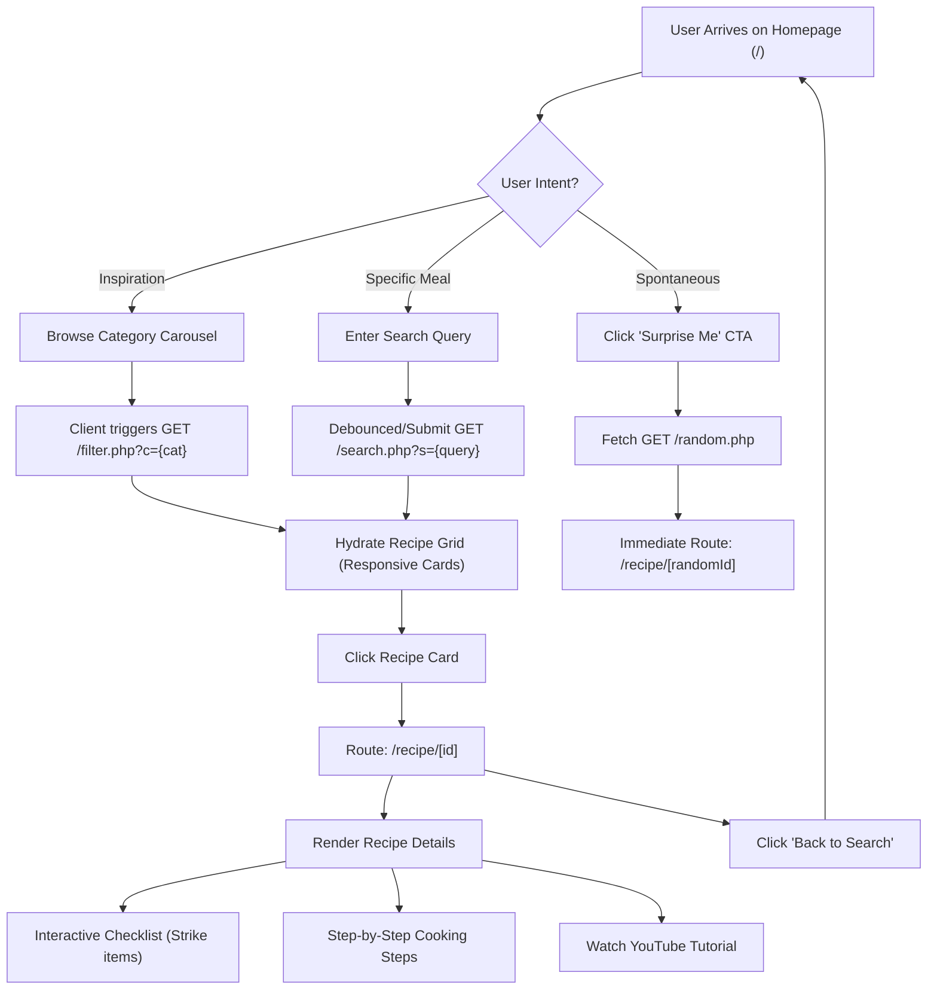
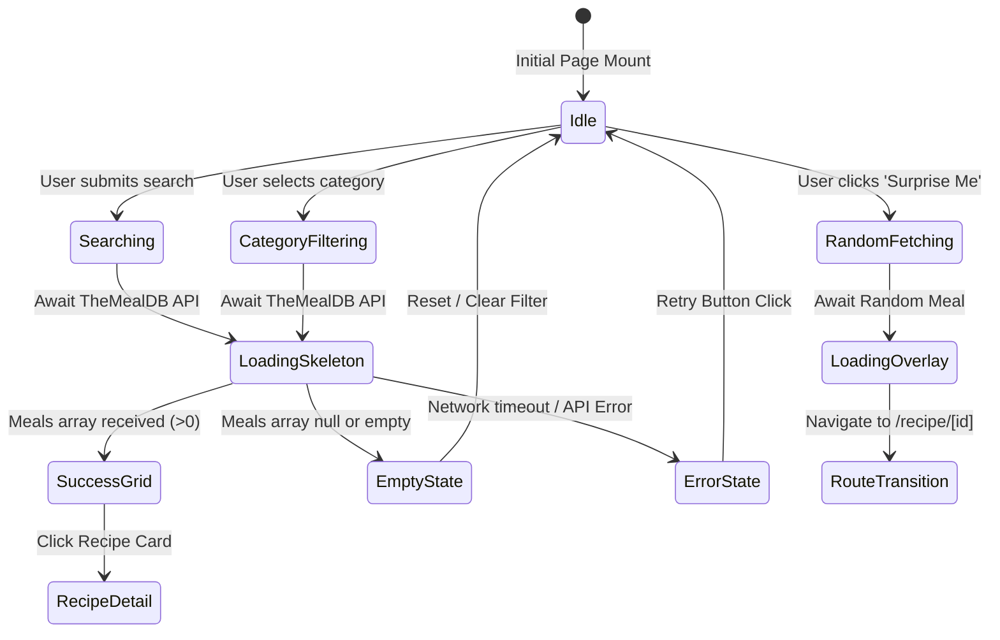

# 🍽️ Dishcovery — Design System & UI/UX Specification
**Version:** 1.0.0  
**Status:** Approved Architecture  
**Target Platform:** Web (Responsive: Mobile, Tablet, Desktop, Wide)  
**Theme:** Warm Culinary Editorial / Modern Epikouros

---

## 1. Executive Design Vision & Creative Direction

### 1.1 Brand Purpose & Essence
**Dishcovery** bridges the gap between chaotic culinary recipe blogs and sterile utilitarian food databases. Most modern recipe websites are cluttered with pop-up ads, lengthy autobiographical essays, and erratic typography that frustrates users who just want to cook. 

Dishcovery delivers an **uncluttered, warm editorial cooking companion**—elevating everyday home cooking into an inspiring, frictionless visual journey.

```
       Inspiring Visuals  +  Zero Clutter  +  Kitchen Ergonomics
       ═════════════════════════════════════════════════════════
                            DISHCOVERY
```

### 1.2 Core Design Principles

| Principle | Meaning & Application |
| :--- | :--- |
| **Warm Editorial Minimalism** | Clean space, warm stone neutrals, and tactile terracotta accents let vibrant culinary photography command focus. No harsh cold grays. |
| **Kitchen Ergonomics** | Designed for real cooking environments: readable at arm's length, oversized tap targets (≥48px) for messy fingers, and sticky checklists. |
| **Immediate Gratification** | Sub-second perceptual loading, progressive image hydration, fluid category switching, and zero banner ads or distraction modals. |
| **Type-Safe Predictability** | Every UI state (Empty, Loading, Error, Success) is explicitly designed and rendered with deterministic TypeScript safety. |

---

## 2. Brand Identity & Visual Language

### 2.1 Logo & Logotype
- **Official Brand Icon (`/public/logo.png`):** An eye-catching warm terracotta dome cloche (`#EA580C` / `#F25C05`) crowned with a deep graphite handle (`#1C1917`), grounded on a sleek platter base, featuring an inset circular white medallion emblazoned with an orange trident-fork emblem (`Ψ`), accented with warm golden discovery sparkles.
- **Logotype:** Modern grotesque sans-serif in `font-bold` tracking tightly (`tracking-tight`), combining deep charcoal with a terracotta period accent: **Dishcovery<span style="color: #EA580C;">.</span>**
- **Favicon & Web App Icon (`/public/favicon.png`, `src/app/icon.png`, `src/app/apple-icon.png`):** The official cloche medallion rendered in high-fidelity PNG/SVG, ensuring instant recognition at standard 16×16, 32×32, and 180×180 touch-icon resolutions.


### 2.2 Iconography Standards
- **Icon Suite:** `lucide-react`
- **Stroke Width:** `1.75px` across all icons (providing an elegant, refined balance between thin wireframes and heavy glyphs).
- **Size Scale:**
  - Micro / Inline: `14px` (`w-3.5 h-3.5`)
  - Standard UI: `18px` (`w-4.5 h-4.5` or `w-[18px] h-[18px]`)
  - Section Headers: `22px` (`w-5.5 h-5.5`)
  - Hero / Empty State: `40px` - `48px` (`w-10 h-10` to `w-12 h-12`)

### 2.3 Imagery & Photography Directives
- **Image Source:** TheMealDB CDN (`https://www.themealdb.com/images/media/meals/...`)
- **Aspect Ratios:**
  - Recipe Cards: `4:3` or `1:1` square crop with subtle inner border ring to prevent white plates from bleeding into white cards.
  - Recipe Detail Hero: `16:9` widescreen banner with subtle bottom gradient scrim (`from-black/60 via-transparent to-transparent`).
- **Loading Behavior:** Next.js `<Image />` with `placeholder="blur"` using an ultra-light blurhash base64 placeholder, `sizes` attribute configured per breakpoint, and object-cover positioning.

---

## 3. Design Tokens & Color System

The Dishcovery color system is built around a warm organic foundation (`Stone`), accented by appetite-stimulating terracotta and saffron tones, grounded with deep espresso charcoal for supreme legibility.

### 3.1 Primary & Semantic Color Palette

```
[ Stone 50 ]  #FAFAF9  ── Primary Canvas (Warm Off-White)
[ Stone 100 ] #F5F5F4  ── Secondary Surface / Subdued Cards
[ Stone 200 ] #E7E5E4  ── Dividers, Hairlines & Card Borders
[ Stone 400 ] #A8A29E  ── Placeholder Text & Disabled Icons
[ Stone 600 ] #57534E  ── Secondary Body & Metadata Slate
[ Stone 900 ] #1C1917  ── Primary Typography (Espresso Charcoal)
────────────────────────────────────────────────────────────────
[ Amber 500 ] #F59E0B  ── Warm Saffron Accent / Highlights
[ Orange 600] #EA580C  ── Signature Terracotta / Primary CTA
[ Orange 700] #C2410C  ── Primary Hover & Pressed States
[ Emerald 600]#059669  ── Checked Ingredient / Success State
[ Rose 600 ]  #E11D48  ── YouTube Badge / Favorite Heart / Error
```

### 3.2 Token Mapping Reference

| Token Name | Hex Code | Tailwind Utility | Role / Usage | Contrast Ratio (on Canvas) |
| :--- | :--- | :--- | :--- | :--- |
| `surface-canvas` | `#FAFAF9` | `bg-stone-50` | Full page viewport background | Baseline |
| `surface-card` | `#FFFFFF` | `bg-white` | Elevated recipe cards, search bars, modals | 1.05:1 (Subtle lift) |
| `surface-subtle` | `#F5F5F4` | `bg-stone-100` | Inactive filter pills, code blocks, badges | 1.12:1 |
| `border-subtle` | `#E7E5E4` | `border-stone-200` | Card borders, table dividers, navbar border | 1.35:1 |
| `border-active` | `#EA580C` | `border-orange-600` | Focused input border, active category outline | 3.8:1 |
| `text-primary` | `#1C1917` | `text-stone-900` | Page titles, recipe names, primary body text | **15.2:1 (AAA Pass)** |
| `text-secondary`| `#57534E` | `text-stone-600` | Meta descriptions, measurement values, tags | **5.8:1 (AA Pass)** |
| `text-tertiary` | `#78716C` | `text-stone-500` | Subtitle captions, timestamps, placeholder | 4.6:1 (AA Pass) |
| `brand-primary` | `#EA580C` | `bg-orange-600` | Primary buttons, active badges, highlights | **4.52:1 (AA Pass)** |
| `brand-hover` | `#C2410C` | `bg-orange-700` | Button hover and pressed interaction | 6.2:1 (AAA Pass) |
| `brand-glow` | `rgba(234, 88, 12, 0.15)` | `shadow-orange-500/20` | Glow highlight on active search / hero | Aesthetic |
| `status-success`| `#059669` | `text-emerald-600` | Checked ingredients, completion states | 4.8:1 (AA Pass) |
| `status-danger` | `#E11D48` | `text-rose-600` | Error banners, YouTube media badge, reset | 4.7:1 (AA Pass) |

---

## 4. Typography & Hierarchical Scale

Dishcovery utilizes **Plus Jakarta Sans** (with fallback to `Inter` and system sans-serif) via `next/font/google` for a modern, geometric yet organic aesthetic with warm round counters. For editorial section headers, an optional serif flourish or weighted grotesque gives high-end food magazine appeal.

```
Font Family:
  Primary UI:    'Plus Jakarta Sans', -apple-system, BlinkMacSystemFont, 'Segoe UI', Roboto, sans-serif
  Editorial Opt: 'Newsreader' or 'Playfair Display' (Reserved for Hero / Quote Accents)
```

### 4.1 Type Scale Hierarchy

| Level | Size (px / rem) | Tailwind Class | Line Height | Tracking | Weight | Target Context |
| :--- | :--- | :--- | :--- | :--- | :--- | :--- |
| **Display 1** | `44px / 2.75rem` | `text-4xl md:text-5xl` | `1.15` | `-0.025em` | Bold (`700`) | Hero Headline on Homepage |
| **Heading 1** | `32px / 2.0rem` | `text-2xl md:text-3xl` | `1.2` | `-0.02em` | Bold (`700`) | Recipe Title on Detail Page |
| **Heading 2** | `24px / 1.5rem` | `text-xl md:text-2xl` | `1.3` | `-0.015em` | SemiBold (`600`) | Section titles ("Ingredients", "Instructions") |
| **Heading 3** | `18px / 1.125rem` | `text-lg` | `1.4` | `-0.01em` | SemiBold (`600`) | Recipe Card Titles, Filter headings |
| **Body Large** | `16px / 1.0rem` | `text-base` | `1.6` | `0em` | Regular (`400`) | Cooking instruction paragraphs |
| **Body Base** | `14px / 0.875rem` | `text-sm` | `1.5` | `0em` | Regular (`400`) / Medium (`500`) | Ingredient list items, Search bar text |
| **Caption** | `12px / 0.75rem` | `text-xs` | `1.4` | `+0.01em` | Medium (`500`) | Category badges, origin tags, metadata |
| **Micro / Tag**| `11px / 0.6875rem`| `text-[11px]` | `1.2` | `+0.04em` | Bold (`700`), Uppercase | Pill tags, "YOUTUBE", "RANDOM" pill |

---

## 5. Layout, Spatial Grid & Elevation Foundation

### 5.1 Breakpoint System
Dishcovery is engineered with a strict mobile-first viewport architecture:

```
┌──────────────┬──────────────┬──────────────┬──────────────┬──────────────┐
│  Mobile (sm) │  Phablet(md) │  Tablet (lg) │ Desktop (xl) │  Wide (2xl)  │
│    < 640px   │  640px-767px │ 768px-1023px │1024px-1279px │   ≥ 1280px   │
│   1 Column   │   2 Columns  │   3 Columns  │   4 Columns  │   4 Columns  │
└──────────────┴──────────────┴──────────────┴──────────────┴──────────────┘
```

- **Max Container Width:** `max-w-7xl` (`1280px`) centered with `mx-auto`
- **Page Horizontal Padding:**
  - Mobile (`< 640px`): `px-4` (`16px`)
  - Tablet (`640px - 1024px`): `px-6` (`24px`)
  - Desktop (`> 1024px`): `px-8` (`32px`)

### 5.2 Elevation & Shadow Hierarchy
Shadows are tinted warm with low opacity to emulate soft kitchen ambient natural light:

```css
/* Warm Shadow Token Spectrum */
--shadow-subtle: 0 1px 2px 0 rgba(28, 25, 23, 0.04);
--shadow-card:   0 4px 12px -2px rgba(28, 25, 23, 0.06), 0 2px 6px -2px rgba(28, 25, 23, 0.03);
--shadow-hover:  0 12px 28px -4px rgba(234, 88, 12, 0.12), 0 6px 14px -3px rgba(28, 25, 23, 0.06);
--shadow-modal:  0 24px 48px -12px rgba(28, 25, 23, 0.18);
```

- **Default Card:** `shadow-sm border border-stone-200/80 hover:shadow-xl hover:border-orange-200/60 transition-all duration-300`
- **Floating Controls (Navbar/Search):** `backdrop-blur-md bg-white/90 shadow-sm border-b border-stone-200/80`

### 5.3 Radius Tokens
- **Interactive Badges / Chips:** `rounded-full` (`9999px`) for organic tactile touch.
- **Recipe Cards:** `rounded-2xl` (`16px`) with matching `overflow-hidden` for image containers.
- **Search Bar & Primary Buttons:** `rounded-xl` (`12px`) or `rounded-full`.
- **Modals / Hero Banners:** `rounded-3xl` (`24px`).

---

## 6. Detailed Component Specifications

```
┌────────────────────────────────────────────────────────────────────────┐
│ NAVBAR                                                                 │
│ [🍽️ Dishcovery.]        [Search Input...]        [🎲 Surprise Me]      │
└────────────────────────────────────────────────────────────────────────┘
┌────────────────────────────────────────────────────────────────────────┐
│ HERO SECTION                                                           │
│                  Discover Your Next Delicious Meal                     │
│    Search over thousands of chef-curated recipes & international dishes│
│         [ 🔍 Search recipes by name or ingredient...      (Search) ]   │
└────────────────────────────────────────────────────────────────────────┘
┌────────────────────────────────────────────────────────────────────────┐
│ CATEGORY CAROUSEL                                                      │
│  [✨ All]  [🥩 Beef]  [🍗 Chicken]  [🥗 Vegetarian]  [🍰 Dessert] ...  │
└────────────────────────────────────────────────────────────────────────┘
┌────────────────────────────────────────────────────────────────────────┐
│ RECIPE GRID (3 - 4 Columns)                                            │
│ ┌──────────────┐ ┌──────────────┐ ┌──────────────┐ ┌──────────────┐   │
│ │   [Image]    │ │   [Image]    │ │   [Image]    │ │   [Image]    │   │
│ │ Category/Area│ │ Category/Area│ │ Category/Area│ │ Category/Area│   │
│ │ Recipe Title │ │ Recipe Title │ │ Recipe Title │ │ Recipe Title │   │
│ │ [View Recipe]│ │ [View Recipe]│ │ [View Recipe]│ │ [View Recipe]│   │
│ └──────────────┘ └──────────────┘ └──────────────┘ └──────────────┘   │
└────────────────────────────────────────────────────────────────────────┘
```

---

### 6.1 Persistent Global Navbar (`Navbar.tsx`)

#### Anatomy
1. **Left: Brand Anchor**
   - Icon: Warm amber plate/chef hat icon inside a soft `bg-orange-50` rounded container.
   - Text: `Dishcovery` with orange period dot.
   - Routing: Direct link to `/` with instantaneous scroll-to-top.
2. **Right: Action Cluster**
   - **"Saved Recipes" (Cookbook) Button:**
     - Icon: `Heart` or `BookmarkCheck` from Lucide.
     - Styling: `relative flex items-center gap-1.5 text-stone-700 hover:text-stone-900 bg-stone-100 hover:bg-stone-200/80 px-3.5 py-2 rounded-full text-sm font-semibold transition-colors`.
     - Count Badge: Pill badge (`bg-rose-500 text-white text-[11px] font-bold px-1.5 py-0.2 rounded-full min-w-[20px] text-center`) reflecting count of saved recipes in `localStorage`.
     - Action: Toggles the feed view between live discovery and saved bookmarked meals.
   - **"Surprise Me" CTA Button:**
     - Icon: `Sparkles` or `Dice5` from Lucide.
     - Styling: `bg-orange-50 text-orange-700 hover:bg-orange-100 border border-orange-200/80 font-medium px-4 py-2 rounded-full transition-all`.
     - Behavior: Triggers `GET /random.php`, displays an animated spinning dice icon, then redirects directly to `/recipe/${meal.idMeal}`.
   - **GitHub / External Link:** Subtle icon link (`text-stone-500 hover:text-stone-800`).

#### State Specifications

| State | Visual Treatment |
| :--- | :--- |
| **Resting (Top of Page)** | `bg-white/80 backdrop-blur-md border-b border-transparent` |
| **Scrolled (>20px)** | `bg-white/95 backdrop-blur-lg border-b border-stone-200/90 shadow-xs` |
| **"Surprise Me" Hover** | Subtle scale up `hover:scale-[1.02]`, border warms to `border-orange-300` |
| **"Surprise Me" Loading** | Animated spinning dice icon, button text turns to "Finding..." with `pointer-events-none opacity-80` |

---

### 6.2 Search Architecture & Input (`SearchBar.tsx`)

#### Visual Specification
- **Container:** High-contrast pill or rounded-2xl search container with warm inset shadow and stone boundary.
- **Search Icon:** `Search` icon positioned left in muted slate (`text-stone-400`).
- **Input Field:** Clean sans-serif, `placeholder:text-stone-400`, focus ring in warm terracotta (`focus:ring-2 focus:ring-orange-500/20 focus:border-orange-500`).
- **Clear Action:** A circular `X` button that fades in dynamically when `query.length > 0`.
- **Submit Trigger:** High-energy orange pill button (`Search`) anchored to the right side of the container with arrow icon.

```
┌────────────────────────────────────────────────────────────────────────┐
│  🔍  Search recipes by title (e.g. "Pasta", "Curry")...      [✕] [Search ➔] │
└────────────────────────────────────────────────────────────────────────┘
```

#### Micro-Interactions
- Keyboard Shortcut: Pressing `/` anywhere on the homepage instantly focuses the search input.
- Clear action instantly resets results to initial featured state without a full page reload.

---

### 6.3 Horizontal Category Filter Carousel (`CategoryFilter.tsx`)

#### Visual Specification
- **Scroll Behavior:** Smooth horizontal scroll container with hidden scrollbars (`no-scrollbar`) and soft gradient fade masks on left and right edges on desktop.
- **Category Pill Anatomy:**
  - Inactive State: `bg-stone-100 hover:bg-stone-200/80 text-stone-700 font-medium text-sm px-4 py-2 rounded-full transition-all`
  - Active State: `bg-stone-900 text-white shadow-md shadow-stone-900/10 font-semibold px-4 py-2 rounded-full ring-2 ring-stone-900 ring-offset-2` (Alternatively `bg-orange-600 text-white`)
  - Optional Icon / Thumbnail: Micro category circle (`w-5 h-5 rounded-full object-cover mr-1.5`) pulled directly from TheMealDB category metadata.

#### Category Set
`All`, `Beef`, `Chicken`, `Dessert`, `Lamb`, `Miscellaneous`, `Pasta`, `Pork`, `Seafood`, `Side`, `Starter`, `Vegan`, `Vegetarian`, `Breakfast`, `Goat`.

---

### 6.4 Culinary Recipe Card (`RecipeCard.tsx`)

The central workhorse of the discovery experience. Must balance rich image presentation with instant metadata scanning.

```
┌─────────────────────────────────────────┐
│ ┌─────────────────────────────────────┐ │
│ │                                     │ │
│ │                                     │ │
│ │          MEAL PHOTOGRAPHY           │ │
│ │             (Aspect 4:3)            │ │
│ │                                     │ │
│ │  [ 🏷️ Italian ]        [ 🌍 Area ]  │ │
│ └─────────────────────────────────────┘ │
│                                         │
│  Teriyaki Chicken Casserole             │
│                                         │
│  ─────────────────────────────────────  │
│  [ 🍽️ View Recipe Details       → ]     │
└─────────────────────────────────────────┘
```

#### Detailed Anatomy & Attributes
1. **Thumbnail Container:**
   - Aspect ratio: `aspect-[4/3]` with `overflow-hidden rounded-t-2xl relative`.
   - Hover Effect: Image scales smoothly (`group-hover:scale-105 duration-500 ease-out`).
   - Gradient Scrim: Subtle overlay on bottom 30% of image so badges stay readable regardless of dish brightness.
   - **Floating Favorite Heart Button:** Positioned top-right (`absolute top-3 right-3 z-10 w-9 h-9 rounded-full bg-white/90 backdrop-blur-md flex items-center justify-center text-stone-400 hover:text-rose-500 hover:scale-110 active:scale-90 transition-all shadow-sm`). When saved: `text-rose-500 fill-rose-500 bg-white`.
2. **Category & Origin Badges:**
   - Float over bottom-left of image or directly beneath:
   - Category Badge: `bg-white/90 backdrop-blur-md text-stone-800 text-xs font-semibold px-2.5 py-1 rounded-md shadow-xs`.
   - Origin Tag: Clean text pill with globe icon (`text-stone-500 text-xs flex items-center gap-1`).
3. **Card Body:**
   - Padding: `p-5`.
   - Recipe Title: `text-stone-900 font-bold text-lg line-clamp-1 group-hover:text-orange-600 transition-colors`.
   - Action Footer: Subtle border-t (`border-stone-100 pt-3 mt-3 flex items-center justify-between text-xs font-semibold text-orange-600 group-hover:translate-x-0.5 transition-transform`).

---

### 6.5 Dynamic Recipe Detail View (`/recipe/[id]`)

Designed specifically for the physical reality of cooking in a kitchen—hands might be wet, screens might be placed 3 feet away on a counter.

#### Two-Column Ergonomic Grid (Desktop: `lg:grid-cols-12 lg:gap-12`)

```
┌────────────────────────────────────────────────────────────────────────┐
│  ← Back to Discover Recipes                                            │
│                                                                        │
│  Spicy Arrabiata Penne                                                 │
│  [ 🏷️ Pasta ]  [ 🌍 Italian ]  [ 📺 Video Guide Available ]            │
├───────────────────────────────────┬────────────────────────────────────┤
│ LEFT COLUMN (5 Cols, Sticky)      │ RIGHT COLUMN (7 Cols, Scrollable)   │
│                                   │                                    │
│ ┌───────────────────────────────┐ │ 👨‍🍳 Step-by-Step Instructions      │
│ │                               │ │                                    │
│ │     HIGH-RES MEAL HERO        │ │ 1. Bring a large pot of salted     │
│ │         (16:9 / 4:3)          │ │    water to a rolling boil.        │
│ │                               │ │                                    │
│ └───────────────────────────────┘ │ 2. Heat extra virgin olive oil in  │
│                                   │    a wide pan over medium-low.     │
│ 🛒 Ingredients Checklist         │                                    │
│ [x] 1 lb      Penne Rigate       │ 3. Sauté minced garlic until        │
│ [ ] 4 cloves  Garlic (minced)    │    fragrant and golden (~2 mins).   │
│ [ ] 1/2 tsp   Red Pepper Flakes  │                                    │
│ [ ] 1 can     San Marzano Tomato │ 4. Simmer gently for 15 minutes...  │
│ [ ] Fresh     Basil & Parmesan   │                                    │
│                                   │ ─────────────────────────────────  │
│ [ Progress: 2 of 5 items checked ]│ 📺 Video Masterclass (YouTube)     │
│                                   │ [ Embedded Responsive 16:9 Player] │
└───────────────────────────────────┴────────────────────────────────────┘
```

#### Sub-Component Specifications for Recipe Detail:

##### 1. Sticky Ingredients Checklist (Left Column)
- **Sticky Offset:** `top-24 self-start` so ingredients remain accessible as the cook scrolls through lengthy instructions.
- **Interactive Checkbox:**
  - Clicking any ingredient strikes through the text (`line-through text-stone-400 opacity-60`) and checks a custom emerald box (`bg-emerald-600 text-white`).
  - Stores state locally during session so refreshing does not wipe prep progress.
- **Clear Progress Indicator:** Minimal bar at top: *"3 of 8 ingredients prepped"*.
- **Measure vs Ingredient Typography:**
  - Measurement (`strMeasure`): `font-bold text-stone-900 min-w-[70px] text-right pr-3 font-mono text-sm`.
  - Ingredient Name (`strIngredient`): `text-stone-700 font-medium text-sm`.

##### 2. Step-by-Step Cooking Guide (Right Column)
- **Instruction Formatting:** TheMealDB provides single unstructured text blocks. The Dishcovery parser splits text by sentences or linebreaks (`\r\n\r\n`) into numbered, digestible step cards.
- **Step Card Anatomy:**
  - Number Pill: High-contrast circular badge (`w-8 h-8 rounded-full bg-orange-100 text-orange-700 font-bold flex items-center justify-center`).
  - Text: Generous line height (`leading-relaxed text-stone-700 text-base md:text-lg`).
  - Step Separation: Card borders (`p-5 rounded-2xl bg-white border border-stone-200/80 mb-4 shadow-xs`).

##### 3. Video Masterclass Section
- **YouTube Embed Container:** Pure 16:9 ratio wrapper (`relative aspect-video rounded-2xl overflow-hidden shadow-lg border border-stone-200`).
- **Privacy & Performance:** Lazy-loaded with an interactive click-to-play thumbnail or standard Next.js iframe wrapper to protect page load performance.
- **External Fallback:** If iframe embedding is restricted, provides a clean CTA button with red YouTube icon to open directly in a new tab.

---

### 6.6 Skeleton & Loading States (`SkeletonCard.tsx`)

Dishcovery avoids abrupt layout shifts (Cumulative Layout Shift = 0) by using exact skeleton geometry with warm shimmer gradients.

- **Shimmer Base Color:** `bg-stone-200`
- **Shimmer Highlight Color:** `bg-stone-100` via CSS linear-gradient animation:
```css
@keyframes shimmer {
  100% { transform: translateX(100%); }
}
.skeleton-shimmer {
  position: relative;
  overflow: hidden;
  background-color: #E7E5E4;
}
.skeleton-shimmer::after {
  position: absolute;
  top: 0; right: 0; bottom: 0; left: 0;
  transform: translateX(-100%);
  background-image: linear-gradient(
    90deg,
    rgba(255, 255, 255, 0) 0,
    rgba(255, 255, 255, 0.4) 50%,
    rgba(255, 255, 255, 0) 100%
  );
  animation: shimmer 1.5s infinite;
  content: '';
}
```

---

### 6.7 Zero-Data, Error & 404 States

Every empty or failed state is paired with a clear recovery path:

| State | Visual Graphic / Icon | Copywriting | Primary CTA |
| :--- | :--- | :--- | :--- |
| **Search Not Found** | Bowl with magnifying glass (`SearchX`) | "No recipes found matching '{query}'" | "Clear search" or "Explore Beef & Chicken" |
| **Category Empty** | Empty pantry illustration (`UtensilsCrossed`) | "No dishes listed under this category yet" | "View all categories" |
| **Network Error** | Cloud disconnect icon (`WifiOff`) | "Unable to connect to TheMealDB" | "Retry connection" |
| **404 Recipe Missing**| Broken plate illustration | "Recipe not found or has been moved" | "Return to Discover Feed" |

---

## 7. Responsive Spatial Layouts (ASCII Wireframes)

### 7.1 Desktop Discovery Feed (`/` at `1280px`)

```
┌───────────────────────────────────────────────────────────────────────────────────┐
│ [🍽️ Dishcovery.]                     [🔍 Search recipes...]     [🎲 Surprise Me]  │
├───────────────────────────────────────────────────────────────────────────────────┤
│                                                                                   │
│                            DISCOVER DELICIOUS RECIPES                             │
│                  Explore hand-crafted culinary ideas from around the world         │
│                                                                                   │
│               ┌────────────────────────────────────────────────────┐              │
│               │ 🔍 Search by ingredient, meal name, or country...   │ [ Search ]   │
│               └────────────────────────────────────────────────────┘              │
│                                                                                   │
│  [✨ All] [🥩 Beef] [🍗 Chicken] [🍰 Dessert] [🥗 Vegetarian] [🍝 Pasta] [🐟 Fish] │
│                                                                                   │
├───────────────────────────────────────────────────────────────────────────────────┤
│                                                                                   │
│  Showing 24 Popular Dishes                                         Filter: [All ▾]│
│                                                                                   │
│  ┌────────────────┐  ┌────────────────┐  ┌────────────────┐  ┌────────────────┐   │
│  │ ┌────────────┐ │  │ ┌────────────┐ │  │ ┌────────────┐ │  │ ┌────────────┐ │   │
│  │ │            │ │  │ │            │ │  │ │            │ │  │ │            │ │   │
│  │ │   IMAGE    │ │  │ │   IMAGE    │ │  │ │   IMAGE    │ │  │ │   IMAGE    │ │   │
│  │ │ [Italian]  │ │  │ │ [Mexican]  │ │  │ │ [American] │ │  │ │ [Japanese] │ │   │
│  │ └────────────┘ │  │ └────────────┘ │  │ └────────────┘ │  │ └────────────┘ │   │
│  │ Lasagna Rollup │  │ Birria Tacos   │  │ Smash Burger   │  │ Salmon Teriyaki│   │
│  │ View Recipe →  │  │ View Recipe →  │  │ View Recipe →  │  │ View Recipe →  │   │
│  └────────────────┘  └────────────────┘  └────────────────┘  └────────────────┘   │
│                                                                                   │
│  ┌────────────────┐  ┌────────────────┐  ┌────────────────┐  ┌────────────────┐   │
│  │   [Card 5]     │  │   [Card 6]     │  │   [Card 7]     │  │   [Card 8]     │   │
│  └────────────────┘  └────────────────┘  └────────────────┘  └────────────────┘   │
│                                                                                   │
├───────────────────────────────────────────────────────────────────────────────────┤
│ Dishcovery © 2026 • Powered by TheMealDB • Crafted with Next.js & Tailwind CSS    │
└───────────────────────────────────────────────────────────────────────────────────┘
```

### 7.2 Mobile Feed View (`390px` Viewport)

```
┌─────────────────────────────────────┐
│ [🍽️ Dishcovery.]    [🎲 Surprise Me]│
├─────────────────────────────────────┤
│ 🔍 Search recipes or dishes...      │
├─────────────────────────────────────┤
│ [All] [Beef] [Chicken] [Dessert] ➔  │
├─────────────────────────────────────┤
│ ┌─────────────────────────────────┐ │
│ │ ┌─────────────────────────────┐ │ │
│ │ │                             │ │ │
│ │ │         IMAGE (4:3)         │ │ │
│ │ │                             │ │ │
│ │ │ [Italian] [Pasta]           │ │ │
│ │ └─────────────────────────────┘ │ │
│ │ Lasagna Bolognese Classic       │ │
│ │ View Recipe Steps ➔             │ │
│ └─────────────────────────────────┘ │
│ ┌─────────────────────────────────┐ │
│ │ [Next Recipe Card]              │ │
│ └─────────────────────────────────┘ │
└─────────────────────────────────────┘
```

---

## 8. UX Architecture & Interaction Flows

### 8.1 Primary User Navigation Flow



### 8.2 Client State Transition Engine



---

## 9. Micro-Interactions, Motion & Transitions

Dishcovery applies subtle, physics-based motion to heighten tactile feedback without adding cognitive load or motion sickness.

### 9.1 Timing & Easing Curves

```css
:root {
  --ease-snappy: cubic-bezier(0.16, 1, 0.3, 1);  /* Enter / Open */
  --ease-smooth: cubic-bezier(0.4, 0, 0.2, 1);   /* Standard State */
  --duration-fast: 150ms;
  --duration-normal: 250ms;
  --duration-slow: 400ms;
}
```

### 9.2 Motion Matrix

| UI Component | Trigger | Transition Effect | Tailwind Implementation |
| :--- | :--- | :--- | :--- |
| **Recipe Card** | Hover | Card lifts 4px, shadow blooms warm amber, image scales 4% | `hover:-translate-y-1 hover:shadow-xl transition-all duration-300` |
| **Category Pill** | Click | Pill scales down slightly on press, border outline snaps | `active:scale-95 transition-transform duration-100` |
| **Ingredient Item**| Click | Checkbox ticks with bounce, label strikethroughs with fade | `transition-all duration-200 ease-out` |
| **Search Input** | Focus | Subtle ring glow expands from border | `focus:ring-4 focus:ring-orange-500/15 duration-200` |
| **Surprise Me** | Click | Icon rotates 180 degrees while loading next meal | `animate-spin duration-700` |

---

## 10. Accessibility (a11y) & Hands-Free Ergonomics

Because Dishcovery is used in real kitchens, accessibility is not merely an afterthought—it is a core functional requirement.

### 10.1 Cooking Ergonomics ("Chef Mode")
- **High Readability at 3 Feet:** Body font size on the recipe detail page scales up to `18px` (`text-lg`) on tablets and desktops with a `1.7` line-height ratio, making steps readable while chopping vegetables.
- **Large Click/Tap Targets:** Every button, filter pill, and ingredient checkbox has a minimum target bounding box of **48 × 48 pixels** (`min-h-[44px] min-w-[44px]`), preventing accidental mis-taps when fingers are wet or oily.
- **Persistent Progress:** Checkboxes provide high-contrast visual feedback (`emerald-600` vs `stone-300`) to enable quick orientation when looking back at the screen after completing a step.

### 10.2 WCAG 2.1 Compliance Checklist
- [x] **Color Contrast:** All text tokens meet or exceed WCAG 2.1 AA requirements (minimum 4.5:1 for standard text, 3:1 for large text).
- [x] **Focus Indicators:** Custom high-visibility focus ring on all interactive elements: `focus-visible:outline-none focus-visible:ring-2 focus-visible:ring-orange-600 focus-visible:ring-offset-2`.
- [x] **Semantic HTML:** Strict usage of `<main>`, `<header>`, `<nav>`, `<section>`, `<article>`, and `<h1>`-`<h3>` hierarchy.
- [x] **Screen Reader Alt Text:** All recipe imagery uses descriptive dynamic alt tags: `alt={`Photo of ${meal.strMeal}`}`.
- [x] **Keyboard Navigation:** Full tab-stop sequence through Navbar -> Search -> Filters -> Recipe Cards with zero keyboard traps.

---

## 11. Tailwind CSS Implementation Architecture

### 11.1 Tailwind Configuration Extension (`tailwind.config.ts`)

```typescript
import type { Config } from 'tailwindcss';

const config: Config = {
  content: [
    './src/pages/**/*.{js,ts,jsx,tsx,mdx}',
    './src/components/**/*.{js,ts,jsx,tsx,mdx}',
    './src/app/**/*.{js,ts,jsx,tsx,mdx}',
  ],
  theme: {
    extend: {
      colors: {
        brand: {
          50: '#FFF7ED',
          100: '#FFEDD5',
          200: '#FED7AA',
          500: '#F97316',
          600: '#EA580C', // Signature Terracotta
          700: '#C2410C',
        },
        surface: {
          canvas: '#FAFAF9', // Stone 50
          card: '#FFFFFF',
          subtle: '#F5F5F4', // Stone 100
        },
      },
      fontFamily: {
        sans: ['var(--font-jakarta)', 'system-ui', 'sans-serif'],
      },
      boxShadow: {
        'warm-sm': '0 1px 3px 0 rgba(28, 25, 23, 0.05)',
        'warm-md': '0 4px 12px -2px rgba(28, 25, 23, 0.08), 0 2px 6px -2px rgba(28, 25, 23, 0.04)',
        'warm-lg': '0 12px 24px -4px rgba(234, 88, 12, 0.12), 0 4px 12px -2px rgba(28, 25, 23, 0.06)',
      },
    },
  },
  plugins: [],
};

export default config;
```

### 11.2 Root Styling & Font Definition (`src/app/layout.tsx`)

```typescript
import { Plus_Jakarta_Sans } from 'next/font/google';
import './globals.css';

const jakarta = Plus_Jakarta_Sans({
  subsets: ['latin'],
  display: 'swap',
  variable: '--font-jakarta',
  weight: ['400', '500', '600', '700', '800'],
});

export const metadata = {
  title: 'Dishcovery — Discover Delicious Recipes & Cooking Inspiration',
  description: 'Clean, warm editorial recipe discovery app powered by TheMealDB.',
};

export default function RootLayout({
  children,
}: {
  children: React.ReactNode;
}) {
  return (
    <html lang="en" className={jakarta.variable}>
      <body className="bg-surface-canvas text-stone-900 min-h-screen antialiased flex flex-col font-sans selection:bg-orange-100 selection:text-orange-900">
        {children}
      </body>
    </html>
  );
}
```

---

## 12. Engineering Hand-Off Checklist

Before merging feature pull requests or deploying to Vercel, verify against the following quality criteria:

- [ ] **Lighthouse Performance:** Score ≥ 90 (Proper image sizes, Next.js image optimization enabled).
- [ ] **Lighthouse Accessibility:** Score 100 (Alt text present on all images, high contrast tokens verified).
- [ ] **Dynamic Layout Stability (CLS):** Zero layout shift when skeleton transforms to meal grid.
- [ ] **Empty State Handling:** Non-existent search queries trigger clean illustration with action buttons.
- [ ] **Detail Page Hydration:** Long instruction paragraphs parse cleanly into numbered steps.
- [ ] **Ingredients Parsing:** Raw `strIngredient1..20` successfully mapped to typed `{ ingredient, measure }[]` pairs without blank or null rows.
- [ ] **Responsive Resizing:** Test flawlessly at `375px` (iPhone), `768px` (iPad portrait), `1024px` (iPad landscape), and `1440px` (Desktop).

---
*Document maintained by the Dishcovery Design & Frontend Engineering Team.*
